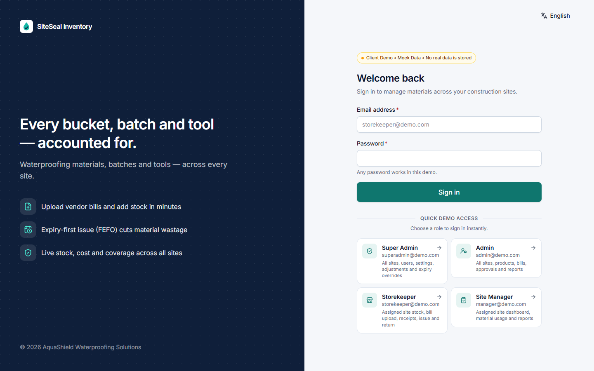
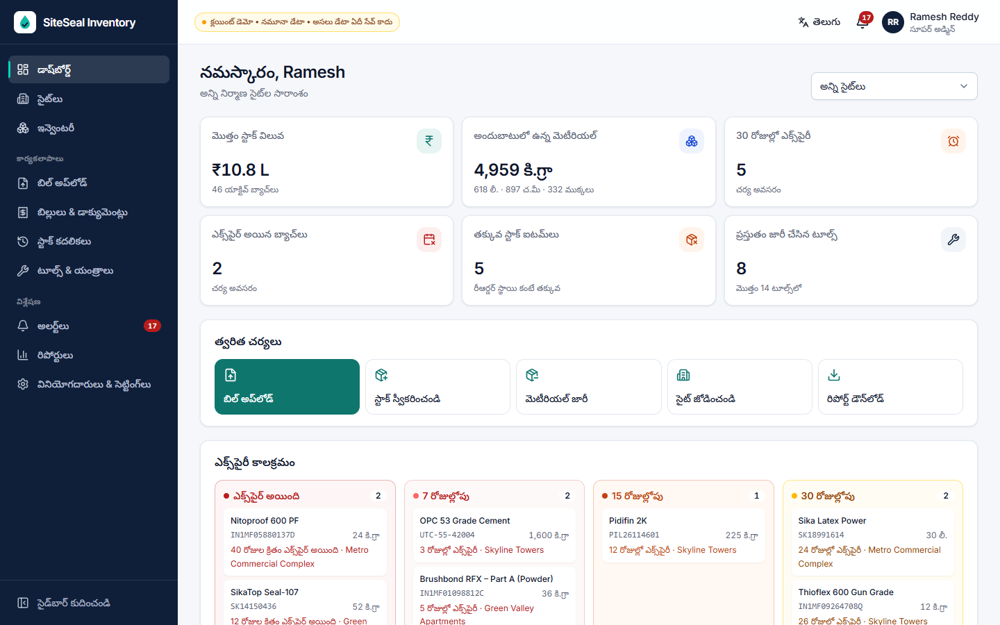
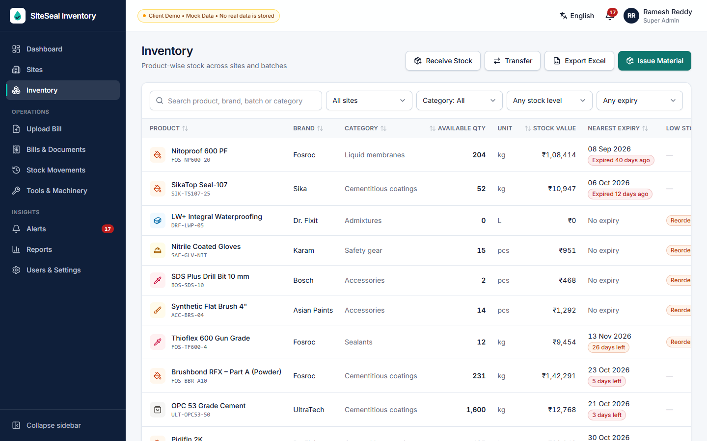
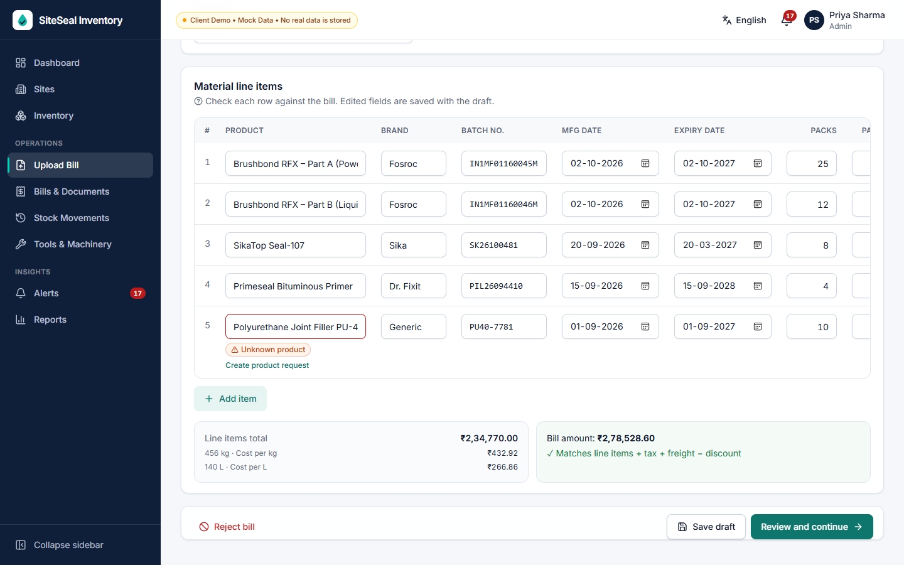
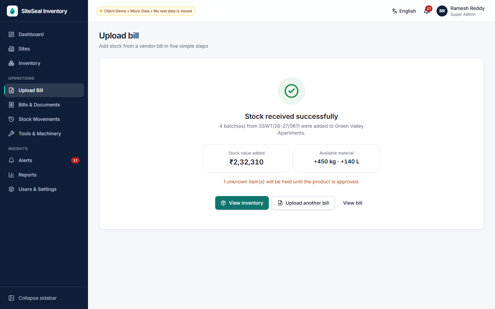
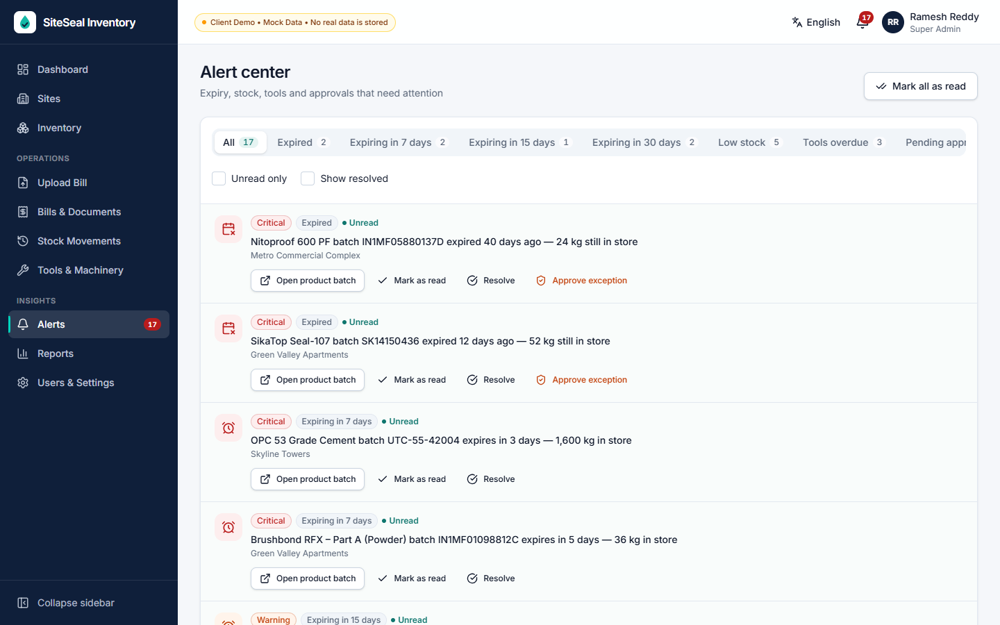
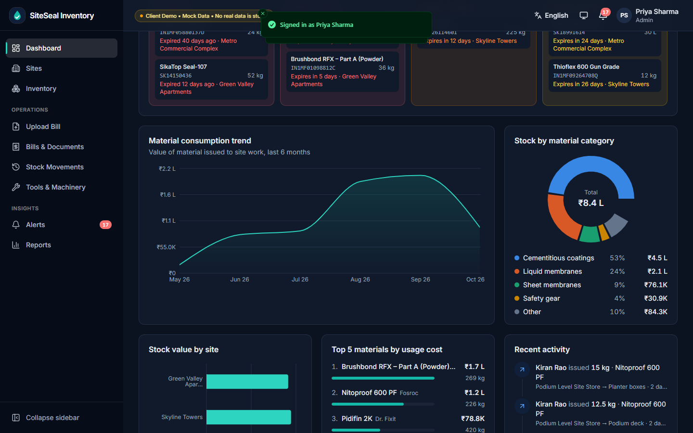
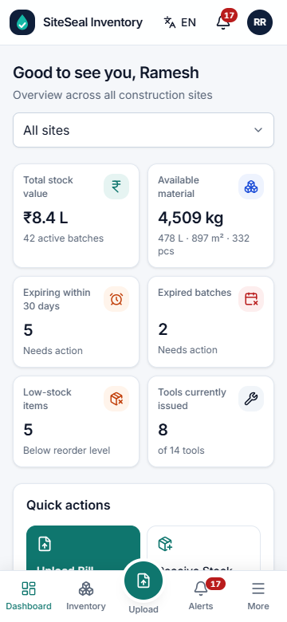
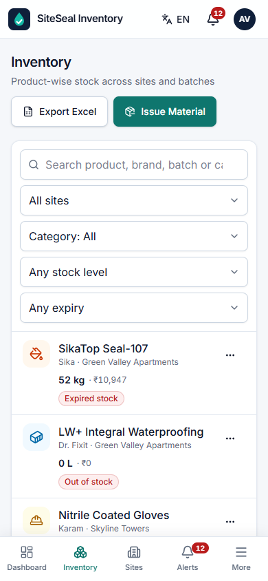
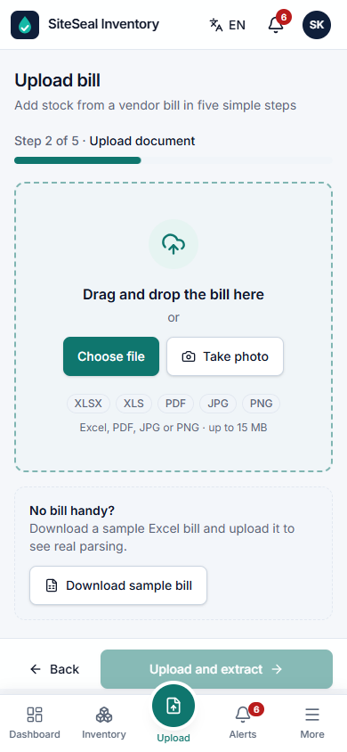

# SiteSeal Inventory

**Multi-site inventory for waterproofing and construction companies** — materials, product batches, expiry, vendor bills, stock usage, tools and reports in one mobile-friendly dashboard.

> ⚠️ **Client demo — mock data only.** This is a clickable prototype for collecting client feedback before backend/API integration. There is no server, no real authentication, no OCR and no cloud storage. Everything runs in the browser, and demo edits are kept in `localStorage`. **No real data is stored.**



---

## What the demo shows

The prototype walks through the full client flow:

```text
Login → Dashboard → Select / create site → Upload bill (Excel / PDF / photo)
→ Simulated extraction → Review & correct fields → Confirm stock receipt
→ Inventory updated by product and batch → Issue material to site work
→ Track usage, stock, cost, expiry, tools and reports
```

### Features

| Area | Highlights |
|---|---|
| **Login & roles** | Split-layout login, 4 one-click demo roles, role shown in the user menu, route guards per role |
| **Dashboard** | 6 KPI cards, stock value by site, 6-month consumption trend, category mix donut, expiry timeline (expired / 7 / 15 / 30 days), top 5 materials by usage cost, recent activity, quick actions, skeleton loaders |
| **Sites** | Grid/table toggle, site cards with stock value, materials, expiry alerts and progress; *Create Site* sheet; site detail tabs: Overview, Stock, Batches, Bills, Usage, Tools, Reports |
| **Inventory** | Product × site stock table with search (product, brand, batch, category), filters (site, category, stock status, expiry), sorting, pagination, Excel export; phone layout uses stacked cards |
| **Product drawer** | Overview (SKU, pack size, shelf life, coverage, coats, cost per kg/L, reorder level), Batches with **FEFO pick**, Stock movements, Usage & coverage calculator, Documents |
| **Upload Bill** | 5-step flow: site → drag-and-drop / camera upload → staged extraction → editable review → confirm. Real `.xlsx` parsing, file-type and size validation, duplicate-bill warnings, product autocomplete, *unknown product* badge with *Create product request*, add / remove / **split batch**, automatic pack→kg/L conversion, cost per kg/L, bill total cross-check, draft save, *Approve and Add to Stock*, success summary |
| **Stock movements** | Shared sheets for **Issue**, **Return**, **Transfer**, **Damage / wastage** and **Stock adjustment** (Super Admin). Issue shows `Expected = Area × Coverage × Coats × Wastage` and suggests the FEFO batch. Every quantity change writes an audit record |
| **Alerts** | Expired, expiring in 7 / 15 / 30 days, low stock, tools overdue, pending approval. Mark read, resolve, open batch / bill / tool, send reminder, approve expiry exception (Super Admin) |
| **Tools & machinery** | Kept separate from consumables. Status summary, filters, detail drawer, issue / return, damage report, maintenance history, mark serviced |
| **Reports** | Date / site / category / product filters, chart previews and **real `.xlsx` downloads** for 8 reports: stock by site, batch expiry, usage vs expected coverage, wastage, cost per m², vendor price comparison, tool issue/return, stock value |
| **Languages** | English, हिन्दी (Hindi), తెలుగు (Telugu) — all fixed UI text, with localised month names. Product names, brands, batch and invoice numbers are not translated |
| **Responsive** | Desktop sidebar (collapsible), collapsed rail on tablet with overlay drawer (tap to expand, Esc to close), top bar + bottom navigation on phones, two-column KPI cards and stacked list cards on phones, sticky primary actions, 44 px touch targets, no horizontal page scroll down to 360 px |
| **Light / dark theme** | Light, dark or follow-the-system, switchable from the header (and the login page and the phone *More* menu); remembered per browser. All colours come from `src/config/theme.json` |
| **Installable PWA** | Web app manifest, icons and an offline-ready service worker (whole app shell precached). *Install app* button when the browser offers it, update prompt for new versions, offline banner |
| **Configurable** | Labels, branding, business rules, navigation, dashboard widgets, roles, catalog lists and colours live in `src/config/*.json` — see [Configuration](#configuration) |
| **Accessibility** | Semantic HTML, labelled controls, `aria-label` on icon buttons, visible focus rings, keyboard-friendly menus/dialogs (Radix), skip link, `prefers-reduced-motion` respected |

### Screenshots

| | |
|---|---|
|  Dashboard (Telugu) |  Inventory |
|  Bill review with unknown-product warning |  Stock received |
|  Alert center |  Dark theme |
|   Phone layout |  Phone upload |

_Placeholders for the client deck: replace with fresh captures after feedback rounds._

---

## Demo credentials

Use **any password**. Or click a role under *Quick demo access*.

| Email | Role | Sees |
|---|---|---|
| `superadmin@demo.com` | Super Admin | Everything, incl. users & settings, stock adjustments, expiry overrides |
| `admin@demo.com` | Admin | All sites, products, bills, approvals, reports |
| `storekeeper@demo.com` | Storekeeper | Green Valley Apartments only — stock, bill upload, receipt, issue / return / transfer. No reports |
| `manager@demo.com` | Site Manager | Green Valley + Skyline Towers — dashboard, material usage (issue), damage reports, reports. No bills |

**Reset demo data**: user menu (top right) → *Reset demo data*, or *Users & Settings* for Super Admin.

### Suggested 5-minute client walkthrough

1. Sign in as **Storekeeper** on a phone (or narrow the browser).
2. Tap **Upload** → choose the site → **Download sample bill**, then upload that same file.
3. Watch extraction, then on review notice the **Unknown product** row → *Create product request*; try **Split** on a row.
4. *Review and continue* → **Approve and Add to Stock**. Open **Inventory**: quantities, KPIs and movements are updated.
5. Open *Brushbond RFX – Part A* → **Issue**: the FEFO batch (expiring in 5 days) is pre-selected; enter area 40 m² and see the expected-usage calculation.
6. Switch language to **తెలుగు** or **हिन्दी**, and the theme to **Dark**, from the header.
7. Sign out, sign in as **Super Admin** → **Alerts** → *Approve exception* on an expired batch → **Reports** → *Download Excel*.

Tip: uploading a file whose name contains `duplicate` triggers the duplicate-invoice warning.

---

## Tech stack

| Concern | Choice |
|---|---|
| Framework | React 19 + TypeScript (strict) + Vite |
| Styling | Tailwind CSS v4, shadcn/ui-style components on Radix primitives |
| Icons / motion | `lucide-react`, `motion/react` with `LazyMotion` + `MotionConfig reducedMotion="user"` |
| Data | `@tanstack/react-query` over a typed mock API |
| Forms | `react-hook-form` + `zod` |
| Charts | `recharts` (lazy-loaded with chart pages) |
| i18n | `i18next` + `react-i18next`; Hindi/Telugu are type-checked against English so missing keys fail the build |
| Files | `react-dropzone`; SheetJS `xlsx` (dynamically imported) for parsing bills and exporting reports |
| Dates | `date-fns` with `en-IN`, `hi`, `te` locales — `dd MMM yyyy`, ₹ with Indian lakh/crore grouping |
| Toasts | `sonner` |
| PWA | `vite-plugin-pwa` (Workbox) — manifest and icons generated from `src/config/app.json` and `public/favicon.svg` |

SheetJS is installed from the official SheetJS CDN tarball (`xlsx-0.20.3`) because the npm registry copy is outdated and has known advisories.

## Routes and navigation

The app includes a public landing page, login flow, and role-based access control:

| Route | What it shows | Auth required |
|---|---|---|
| `/` | Public home page with stats, features and demo role carousel. Signed-in users see a shortcut to the dashboard | No |
| `/login` | Login page. Signed-in users are redirected to the dashboard. Accepts an optional `?redirect=` param to return users after sign-in (misspelled URLs, for example) | No |
| `/logout` | Clears the session and redirects to `/login` | Yes |
| `/dashboard` | Main dashboard with KPIs, stock summary and quick actions | Yes |
| `/sites`, `/sites/:siteId` | Site list and detail page (tabs: Overview, Stock, Batches, Bills, Usage, Tools, Reports) | Yes (Super Admin + Admin see all; Storekeeper sees assigned; Manager sees assigned) |
| `/inventory` | Searchable stock table by product and site, with filters and Excel export | Yes (Super Admin + Admin + Storekeeper) |
| `/upload` | 5-step bill upload flow (site → file → extraction → review → confirm) | Yes (upload_bills permission) |
| `/bills` | List of uploaded bills (Super Admin + Admin + Storekeeper can view; view_bills permission) | Yes |
| `/movements` | Stock movement history (issues, returns, transfers, damage, adjustments) | Yes |
| `/alerts` | Alert center (expiry, low stock, overdue tools, pending approvals) | Yes |
| `/tools` | Tools and machinery inventory (status, maintenance, issue/return/damage) | Yes |
| `/reports` | Data export (8 report types with filters and live `.xlsx` download) | Yes (view_reports permission) |
| `/admin` | Users & settings (Super Admin only) | Yes (manage_users permission) |
| `/*` | 404 page with search suggestion, did-you-mean link, and popular pages | No |

### Route aliases

Misspelled URLs are automatically corrected:

```json
{
  "/dashbord": "/dashboard",
  "/dashboad": "/dashboard",
  "/dasboard": "/dashboard",
  "/home": "/",
  "/app": "/dashboard",
  "/signin": "/login",
  "/sign-in": "/login",
  "/signout": "/logout",
  "/stock": "/inventory",
  "/inventry": "/inventory",
  "/bill": "/bills",
  "/uploads": "/upload",
  "/alert": "/alerts",
  "/report": "/reports",
  "/tool": "/tools",
  "/site": "/sites",
  "/settings": "/admin",
  "/users": "/admin"
}
```

If the URL doesn't match an alias, the 404 page uses Levenshtein distance to suggest the nearest path.

### SPA fallbacks

For hosting platforms that don't natively support single-page routing (and to keep the app indexable at various URIs):

| File | Purpose |
|---|---|
| `public/_redirects` | Netlify / Vercel rewrite config |
| `vercel.json` | Explicit Vercel rewrite (ignores asset and file extensions) |
| `dist/404.html` | Copy of `index.html` (created during build); serves the SPA when a route is not found at static hosting |

## Getting started

Requires Node.js 20+.

```bash
npm install
npm run dev        # http://localhost:5173
npm run build      # type-check + production build
npm run preview    # serve the production build
```

## Project structure

```text
src/
  config/               Everything configurable (see "Configuration")
    i18n/               en.json · hi.json · te.json — every UI label
    app.json · business.json · catalog.json · dashboard.json · navigation.json · roles.json · theme.json
    index.ts            Typed access to the JSON · icons.ts (icon names → components) · tones.ts (colour classes)
  data/
    mock/*.json         Mock backend data (reference contract for the real API)
    index.ts            Loads the JSON and shifts dates so demo cases stay current
  services/             mockApi.ts (the only data entry point), db (localStorage), selectors, session
  components/
    ui/                 Primitives, by kind: button/ · display/ · form/ · overlay/   → import from '@/components/ui'
    common/             Shared app components: brand/ · data-display/ · feedback/ · inputs/ · layout/ · status/ · table/
                        → import from '@/components/common'
    layout/             AppLayout, Sidebar, MobileNav (bottom bar + More sheet), header/ controls, navigation.ts
  features/             auth · admin · dashboard · sites · inventory · bills (+ upload/) · stock · tools · reports
  pages/                Route-level pages (lazy-loaded)
  theme/                ThemeProvider (light/dark/system) and CSS-variable injection from theme.json
  pwa/                  Install prompt, service-worker update prompt, online status
  hooks/ · lib/ · utils/ · types/ · i18n/
```

Reusable building blocks used across pages include `SectionCard`, `KpiCard` / `KpiGrid`, `QueryState` (loading → error → empty → content), `FilterBar`, `SiteSelect`, `CategorySelect`, `SearchInput`, `Segmented`, the `DataTable` sort/pagination helpers and the config-driven status badges.

## Configuration

Nothing user-visible is hard-coded in components: edit the JSON in `src/config/` and rebuild.

| File | What it controls |
|---|---|
| `i18n/en.json`, `hi.json`, `te.json` | Every label, message, placeholder and system text. Hindi/Telugu must have exactly the English keys — the build fails otherwise |
| `app.json` | App name and PWA colours, locale (currency, number and date formats, languages), default theme, **feature flags** (demo badge, theme toggle, language switch, camera upload, sample bill, install prompt, reset demo), demo logins, API delay, page sizes |
| `business.json` | Wastage allowance, expiry windows (7 / 15 / 30 days), tax rate, freight, duplicate-bill rules, product-match threshold, upload types and size limit, Excel column aliases, tool issue/service days, default report range |
| `catalog.json` | Material categories, units, product icons, status/tone/icon mapping for stock, expiry, bills, movements, tools, sites and alerts; report list and formatting |
| `dashboard.json` | KPI cards (order, icon, colour, link), quick actions, which widgets show, list limits |
| `navigation.json` | Sidebar sections and items (icon, label, required permission, badge) and the phone bottom bar |
| `roles.json` | Role → permission matrix and the rows shown on *Users & Settings* |
| `theme.json` | Light and dark colour tokens and chart palettes. They are injected as CSS variables at startup, so a new brand colour needs only this file |

## Mock data

All demo data lives in `src/data/mock/*.json` — `company`, `users`, `sites`, `vendors`, `products`, `batches`, `invoices`, `stockMovements`, `tools`, `toolIssues`, `auditLogs`, plus `extractionSample.json` (the canned OCR result for PDF/photo bills) and `sampleBill.json` (the downloadable Excel bill). The shapes match `src/types` and serve as the **reference contract for the backend API**.

- 3 sites (Hyderabad, Vijayawada, Visakhapatnam), 7 users, 4 vendors, 20 products (Fosroc Brushbond RFX, Dr. Fixit Pidifin 2K, SikaTop Seal-107, primers, PU/APP membranes, HDPE dimple board, fibreglass mesh, sealants, rollers, drill bits, safety gear), 14 tools, 43 batches, 201 stock movements, 21 bills.
- The JSON holds real ISO dates. `meta.json` records the `referenceDate`; at load time every date is shifted by *today − referenceDate*, so expired, expiring-soon and overdue cases always look current.
- Batch `IN1MF01134887H` (Fosroc, 10 kg, mfg 26/05/2026, ₹608.60/kg) mirrors a real product label.
- Every batch's available quantity equals the sum of its movement records (receipts − issues + returns − write-offs ± transfers/adjustments).
- If you change the JSON, bump `version` in `meta.json` so browsers discard their saved demo state.

### Limitations (by design)

- No backend, no real authentication, no OCR. PDF/photo extraction returns a realistic canned result; **Excel bills are genuinely parsed** in the browser.
- Uploaded files live only in memory for the current tab (object URLs are revoked on reset); they are not persisted.
- Data, preferences (language, theme, sidebar) and demo edits are stored in this browser's `localStorage` only.
- Offline support covers the app itself and the demo data in this browser; nothing syncs between devices.
- Role checks happen in the browser — see the security section below.

---

## Future API integration plan

All data access goes through `src/services/mockApi.ts`; components use React Query hooks from `src/hooks/queries.ts` and typed view models from `src/types`. Integrating a real backend means re-implementing those service functions with `fetch` — **no component redesign required**.

| Mock function | Suggested endpoint |
|---|---|
| `login`, `logout` | `POST /auth/login`, `POST /auth/logout` (httpOnly cookie session) |
| `getDashboard(siteId)` | `GET /dashboard?siteId=` |
| `getSites`, `getSite`, `createSite` | `GET /sites`, `GET /sites/:id`, `POST /sites` |
| `getProducts`, `getProductById` | `GET /products`, `GET /products/:id?siteId=` |
| `getStock`, `getBatches` | `GET /stock?siteId=`, `GET /batches?siteId=&productId=` |
| `getBills`, `getBill` | `GET /bills`, `GET /bills/:id` |
| `uploadBill` | `POST /bills/upload-url` → signed upload to private storage → `POST /bills` |
| `extractBill` | `POST /bills/:id/extract` (async OCR / Excel parsing job; poll or webhook) |
| `saveBillDraft`, `approveBill`, `rejectBill`, `archiveBill` | `PUT /bills/:id`, `POST /bills/:id/approve`, `/reject`, `/archive` |
| `issueMaterial`, `returnMaterial`, `transferStock`, `reportDamage`, `adjustStock` | `POST /stock-movements` with a `type` — one transactional write per movement |
| `getMovements` | `GET /stock-movements?siteId=&productId=&type=&invoiceId=` |
| `getAlerts`, `updateAlerts`, `approveExpiryException` | `GET /alerts`, `PATCH /alerts`, `POST /batches/:id/expiry-override` |
| `getTools`, `issueTool`, `returnTool`, … | `GET /tools`, `POST /tools/:id/issue`, `/return`, `/damage`, `/service` |
| `exportReport` | `GET /reports/:id?from=&to=&siteId=…` (JSON or server-generated `.xlsx`) |

Notes for the backend:

- Stock must only change through movement records, in a database transaction with row locking (FEFO selection and over-issue checks happen server-side).
- Alerts can be computed by a scheduled job or a view; read/resolved state is per user.
- API errors should return an error code (e.g. `insufficientStock`) — the UI already maps codes to translated messages.

## Production security requirements

This demo enforces roles **only in the browser**; that is not security. Before production:

- **Server-side authorization** — every endpoint checks the user's role and site assignment; never trust the client.
- **Secure sessions** — httpOnly, `Secure`, `SameSite` cookies or short-lived access tokens with refresh rotation; MFA for admins; account lockout.
- **Private document storage** — bills and photos in a private bucket, encrypted at rest; never public URLs.
- **Signed uploads / downloads** — short-lived pre-signed URLs; server-side file type and size validation and malware scanning.
- **Audit logs** — immutable, append-only log of who changed what stock, when and why (the UI already records this shape).
- **Input validation** — validate and sanitise all input on the server (schemas shared with the client where possible); parameterised queries.
- **Rate limiting** — on login, uploads, extraction and exports; bot protection on auth.
- **Backup policy** — automated encrypted backups with point-in-time recovery, tested restores, defined retention.
- Also: HTTPS/HSTS, a strict Content Security Policy, dependency scanning, secrets kept out of the frontend, least-privilege service accounts, and monitoring/alerting.

---

_SiteSeal Inventory — client demo build. Mock data only; no real data is stored._

---

## PWA Notification Foundation

The app includes a production-ready PWA notification system with these features:

### For Users

**Notification Bell**
- Shows unread notification count (9+ when exceeding 9)
- Click to open a professional notification panel
- Notifications grouped by date (Today, Yesterday, Earlier)
- Mark individual notifications or all as read
- Click notification to navigate to related alert
- Direct access to full alerts page

**Notification Preferences**
- Enable/disable notifications via browser permission
- Send test notification
- Simulate demo alerts
- iPhone/iPad installation guidance

**App Icon Badge** (where supported)
- System app badge shows unread count
- Automatically updates on read/unread changes
- Falls back to in-app bell when not supported

### For Developers

**Architecture**
```
src/
  features/notifications/
    components/           # React UI components
      NotificationBell.tsx
      NotificationPanel.tsx
      NotificationSettings.tsx
    hooks/               # React Query hooks
      useNotifications.ts
    services/            # Business logic
      notificationService.ts
    types.ts             # TypeScript types
    mockNotifications.ts # Demo data
  pwa/
    badge.ts             # App badge helper
src/sw.ts                # Custom service worker (push events, offline)
```

**Mock Notifications** (current demo state)
- Expiry alerts (7, 15, 30 days)
- Low stock alerts
- Bill approval alerts
- Tool return reminders
- All persisted in localStorage

**Real Push Notifications** (future backend integration)
1. Client registers service worker
2. User grants notification permission
3. Service worker subscribes with `pushManager.subscribe(VAPID_KEY)`
4. Subscription sent to backend at `POST /api/push-subscriptions`
5. Backend stores subscription per user/device
6. Backend sends push events using private VAPID key
7. Service worker receives push and shows native notification

### Configuration

**Environment Variables** (in `.env`)
```env
VITE_VAPID_PUBLIC_KEY=   # Optional: web-push VAPID public key
VITE_PUSH_API_BASE_URL=  # Optional: backend push subscription endpoint
```

The feature works in **demo mode** without these keys (in-app notifications only).

### Testing

1. **Enable notifications**: Click Settings → Notification Preferences → Enable Notifications
2. **Send test**: Settings → Send Test Notification
3. **Simulate demo**: Settings → Simulate Critical Alert
4. **View notifications**: Click bell icon in header
5. **Native push** (when backend connected): Enable notifications + VAPID keys

### Service Worker

The custom service worker (`src/sw.ts`) handles:
- **Push events**: Shows native OS notifications with icon/badge
- **Notification clicks**: Navigates to relevant page, focuses existing window
- **App badge updates**: `navigator.setAppBadge(count)` when supported
- **Offline support**: Precaches app shell and static assets
- **Font caching**: Stale-while-revalidate for Google Fonts

**Never cache:**
- Sensitive API responses (bills, invoices)
- Authenticated user data
- Private documents

### Production Checklist

Before deploying with real push:

- [ ] Generate VAPID keys: `npx web-push generate-vapid-keys`
- [ ] Store private key securely on backend (never expose to frontend)
- [ ] Set `VITE_VAPID_PUBLIC_KEY` env var in build
- [ ] Implement backend endpoints:
  - `POST /api/push-subscriptions` (save subscription)
  - `DELETE /api/push-subscriptions/:id` (remove subscription)
- [ ] Validate all push payloads server-side
- [ ] Test push on iOS Safari (requires installed PWA)
- [ ] Document allowed notification actions (click URL validation)

### Browser Support

| Feature | Chrome | Firefox | Safari | Edge |
|---------|--------|---------|--------|------|
| Install | ✅ | ✅ | ✅ | ✅ |
| Push notifications | ✅ | ✅ | ⚠️ (app) | ✅ |
| App badge | ✅ | ✅ | ❌ | ✅ |
| Service worker | ✅ | ✅ | ✅ | ✅ |

⚠️ = iOS Safari requires installing as PWA first  
❌ = Not supported on this browser

### Security Notes

- Payloads validated before rendering (no HTML injection)
- Notification URLs restricted to same-origin paths
- No sensitive data in localStorage (read/unread state only)
- Service worker never caches authenticated responses
- Push validation happens on backend (private VAPID key)

